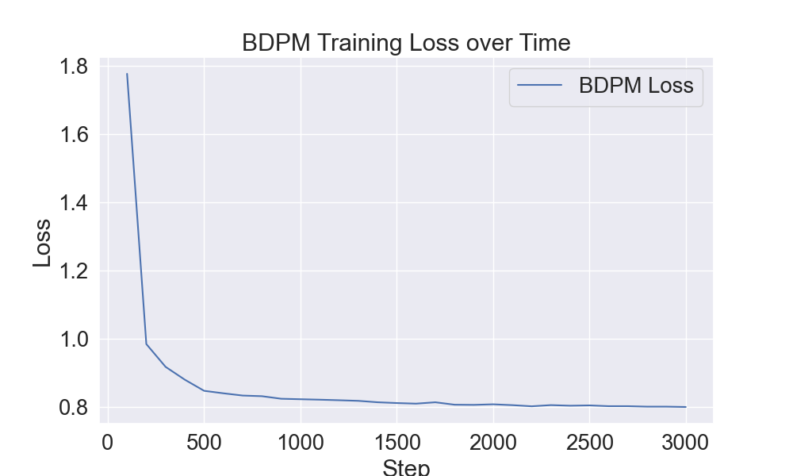
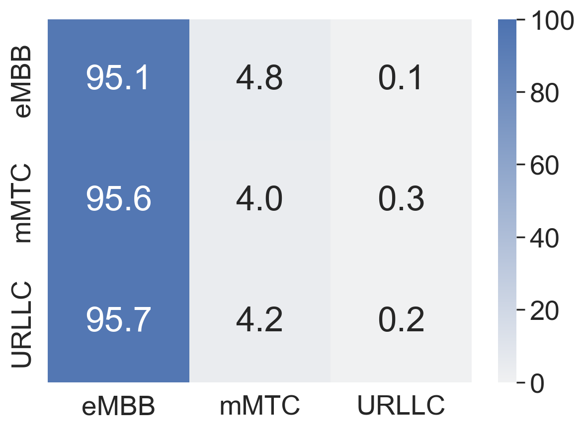
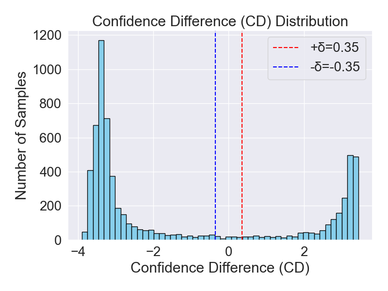
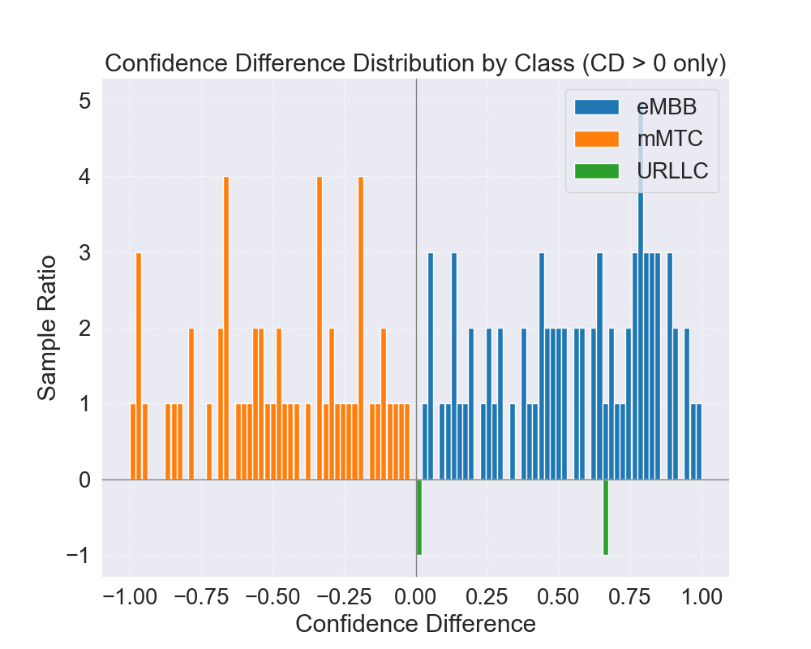

# AdvTabDDPM

AdvTabDDPM generates tabular samples near a traffic classifier's decision boundary and evaluates their effect on a three-class 5G traffic classifier (`eMBB`, `mMTC`, and `URLLC`).

This bundled snapshot is the optional AdvTabDDPM reference plug-in for the
parent AODT project. The current deployment target is the parent project's
self-hosted Ubuntu AI Server.
See [`../VERSION.md`](../VERSION.md) for the authoritative version and
environment record. The default configuration uses a 20-numerical +
3-categorical example schema compatible with the bundled TRACTOR classifier;
other AI plug-ins may define a different adapter and schema.

## Pipeline

```text
Classifier training/evaluation
        ↓
AdvTabDDPM training
        ↓
Synthetic sample generation
        ↓
TRACTOR evaluation
        ↓
Confusion matrix + confidence-difference analysis
```

The `--train` command runs both **AdvTabDDPM training and sampling**, so the documented `--eval` command can be executed immediately afterward.

## Repository layout

```text
AdvTabDDPM.py                         Main CLI entry point
train.py / trainer.py                 AdvTabDDPM training loop
sample.py                             Synthetic sample generation
classifier_*.py                       TRACTOR model, data, training, and evaluation
tab_ddpm/                             Diffusion and BDPM implementation
tddpm_lib/                            TabDDPM data/model utilities
exp/colosseum/ddpm_tune_best/         Canonical experiment configuration
data/colosseum/pickle_to_csv/         Classifier dataset and normalization parameters
data/colosseum_22/                    Diffusion-ready 20+3 feature dataset
classifier_train_result/
  slice_model_train_result/           Bundled pretrained classifier checkpoint
docs/images/                          Example outputs from a validated run
```

Generated checkpoints, arrays, logs, and plots are excluded by `.gitignore`.

## Recorded integration environment

- Ubuntu 24.04.4 LTS x86-64
- Python 3.10.20
- NVIDIA GeForce RTX 3080, 12 GB VRAM
- NVIDIA driver 580.159.03
- PyTorch 2.11.0+cu128; PyTorch CUDA runtime 12.8

## Installation

### 1. Clone the repository

```bash
git clone https://github.com/0425Ning/AdvTabDDPM.git
cd AdvTabDDPM
```

### 2. Create a Python environment

```bash
conda create -n aodt-advtabddpm python=3.10 -y
conda activate aodt-advtabddpm
python -m pip install --upgrade pip setuptools wheel
```

### 3. Install CUDA-enabled PyTorch

```bash
pip install torch==2.11.0 torchvision==0.26.0 torchaudio==2.11.0 --index-url https://download.pytorch.org/whl/cu128
```

### 4. Install project dependencies

```bash
pip install -r requirements.txt
pip install --no-deps -r requirements-legacy.txt
```

`rtdl==0.0.9` and `libzero==0.0.8` publish metadata that requests `torch<2`. Installing them with `--no-deps` prevents pip from replacing the CUDA-enabled PyTorch build.

### 5. Verify CUDA

```bash
python -c "import torch; print(torch.__version__); print(torch.version.cuda); print(torch.cuda.is_available()); print(torch.cuda.get_device_name(0) if torch.cuda.is_available() else 'CPU')"
```

Expected output on the recorded AI Server includes:

```text
2.11.0+cu128
12.8
True
NVIDIA GeForce RTX 3080
```

## Example commands

Run commands from the repository root. Forward-slash paths work in both Windows Anaconda Prompt and Linux shells.

### 1. Classifier training

The repository includes a pretrained classifier, so this step is optional. Running it retrains and writes a new checkpoint to `classifier_train_result/slice_model_train_result/`.

```bash
python AdvTabDDPM.py --config exp/colosseum/ddpm_tune_best/config.toml --ds_path data/colosseum/pickle_to_csv --ds_file colosseum_dataset_globalnorm.pkl --norm_param_file colosseum_global_cols_maxmin.pkl --isNorm --log_base_dir ./classifier_train_result/ --exp_name slice_model_train_result --transformer v1 --slicelen 1
```

### 2. Classifier evaluation

```bash
python AdvTabDDPM.py --config exp/colosseum/ddpm_tune_best/config.toml --ds_path data/colosseum/pickle_to_csv --ds_file colosseum_dataset_globalnorm.pkl --norm_param_file colosseum_global_cols_maxmin.pkl --isNorm --log_base_dir ./classifier_train_result/ --exp_name slice_model_train_result --transformer v1 --slicelen 1 --mode test
```

### 3. AdvTabDDPM training and sampling

This command trains AdvTabDDPM and then automatically generates the configured synthetic dataset.

```bash
python AdvTabDDPM.py --config exp/colosseum/ddpm_tune_best/config.toml --train --ds_path data/colosseum/pickle_to_csv --ds_file colosseum_dataset_globalnorm.pkl --norm_param_file colosseum_global_cols_maxmin.pkl --isNorm --log_base_dir ./classifier_train_result/ --exp_name slice_model_train_result --transformer v1 --slicelen 1 --mode test
```

### 4. AdvTabDDPM evaluation

Run this after the training command has generated `X_num_train.npy`, `X_cat_train.npy`, and `y_train.npy`.

```bash
python AdvTabDDPM.py --config exp/colosseum/ddpm_tune_best/config.toml --eval --ds_path data/colosseum/pickle_to_csv --ds_file colosseum_dataset_globalnorm.pkl --norm_param_file colosseum_global_cols_maxmin.pkl --isNorm --log_base_dir ./classifier_train_result/ --exp_name slice_model_train_result --transformer v1 --slicelen 1 --mode test
```

### Optional: sample again without retraining

```bash
python AdvTabDDPM.py --config exp/colosseum/ddpm_tune_best/config.toml --sample --ds_path data/colosseum/pickle_to_csv --ds_file colosseum_dataset_globalnorm.pkl --norm_param_file colosseum_global_cols_maxmin.pkl --isNorm --log_base_dir ./classifier_train_result/ --exp_name slice_model_train_result --transformer v1 --slicelen 1 --mode test
```

## Default experiment configuration

The canonical config is:

```text
exp/colosseum/ddpm_tune_best/config.toml
```

The checked-in example was executed on a 12 GB RTX 3080:

```toml
[train.main]
steps = 3000
batch_size = 512

[sample]
num_samples = 6500
batch_size = 1024
```

For a longer experiment, change only:

```toml
steps = 30000
```

Keep the smaller batch sizes unless the available GPU memory has been verified.

## Main outputs

Training and sampling write to:

```text
exp/colosseum/ddpm_tune_best/
```

Important files include:

```text
model.pt                              Diffusion denoiser checkpoint
model_ema.pt                          EMA checkpoint
bdpm.pt                               BDPM checkpoint
X_num_train.npy                       Generated numerical features
X_cat_train.npy                       Generated categorical features
y_train.npy                           Generated labels
result/train_loss.csv                 BDPM training-loss history
result/loss_plot.png                  BDPM training-loss plot
```

Evaluation additionally produces:

```text
Results_slice_1.trans_v1_diffusion_test.png
eval_confidence_details.csv
confidence_difference_histogram.png
confidence_difference_distribution.png
cd_quadrant_distribution.png
boundary_zone_inputs.npy
boundary_zone_labels.npy
non_boundary_positive_cd_inputs.npy
non_boundary_positive_cd_labels.npy
results_eval.json
```

## Example results

### BDPM training loss



### Generated-data confusion matrix



### Confidence-difference regions



### Class-wise confidence-difference grouping



## Data compatibility

The diffusion dataset in `data/colosseum_22/` contains:

- 20 numerical features
- 3 categorical features: `RNTI`, `slice_id`, and `scheduling_policy`
- 3 labels: `eMBB`, `mMTC`, and `URLLC`

The classifier preprocessing removes `slice_id`, resulting in the 22-feature input expected by the bundled TRACTOR checkpoint.

`make_colosseum_22.py` documents the conversion from the older 26-numerical + 5-categorical layout to the compatible 20+3 layout.

## Troubleshooting

### PyTorch is replaced by a CPU or older build

Reinstall the validated CUDA build, then reinstall the legacy packages without dependencies:

```bash
pip uninstall -y torch torchvision torchaudio rtdl libzero
pip install torch==2.11.0 torchvision==0.26.0 torchaudio==2.11.0 --index-url https://download.pytorch.org/whl/cu128
pip install --no-deps -r requirements-legacy.txt
```

### `No module named rtdl` or `No module named zero`

```bash
pip install --no-deps -r requirements-legacy.txt
```

### Evaluation cannot find generated NPY files

Run the AdvTabDDPM training command first. It automatically performs sampling. Alternatively, run the standalone `--sample` command.

### CUDA out of memory

Reduce these values in `config.toml`:

```toml
[train.main]
batch_size = 256

[sample]
batch_size = 512
```

## License

The upstream repository did not include a license file. Add an explicit open-source license before accepting external reuse or contributions. Do not publish under a license unless all copyright holders agree.
