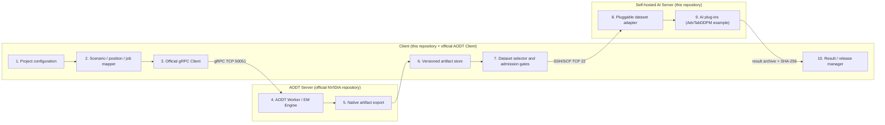

# Architecture

The implementation follows three independently deployed roles.

## Repository mapping

| Diagram block | Implementation |
|---:|---|
| 1-2 | `configs/`, `scripts/aodt/`, and deterministic trajectory tools |
| 3 | External official NVIDIA `client/`; endpoint is `DT_SERVER_ADDRESS` |
| 4 | External official NVIDIA `worker/`; this repository does not copy it |
| 5-7 | stages 07-10, immutable `results/`, validation, lineage, and admission |
| 8 | `scripts/adapter/` and `ai_server/deploy/`; schemas are plug-in specific |
| 9 | `ai_server/AdvTabDDPM/` is one example plug-in with a fixed checkpoint manifest |
| 10 | stage 13 download and checksum preservation |

The AODT Worker IP and AI Server IP are deliberately separate settings. The
Client uses gRPC to the AODT Worker on 50051 and SSH/SCP to the developer's
AI Server on the configured SSH port.

Static and UAV tracks preserve backend-native evidence through stage 08. Stage
09 derives link quantities; stage 10 is the optional legacy AdvTabDDPM example
adapter. Alternative AI plug-ins may define a different schema without using
that example adapter. Stage 11 accepts only a passing selected dataset and creates an isolated copy
of the checked-in AdvTabDDPM project. Stage 12 executes the unchanged command
configuration; stage 13 returns an immutable archive and checksum.

The AI-side plug-in is user-replaceable. A replacement AI project owns its
input schema, adapter, environment, execution command, and model provenance;
the AODT-native artifact and validation stages remain unchanged.

For UAV, zero-power links remain explicit no-coverage observations. Stage 10BU
requires complete serving coverage and never applies an RF floor or outage
imputation.
